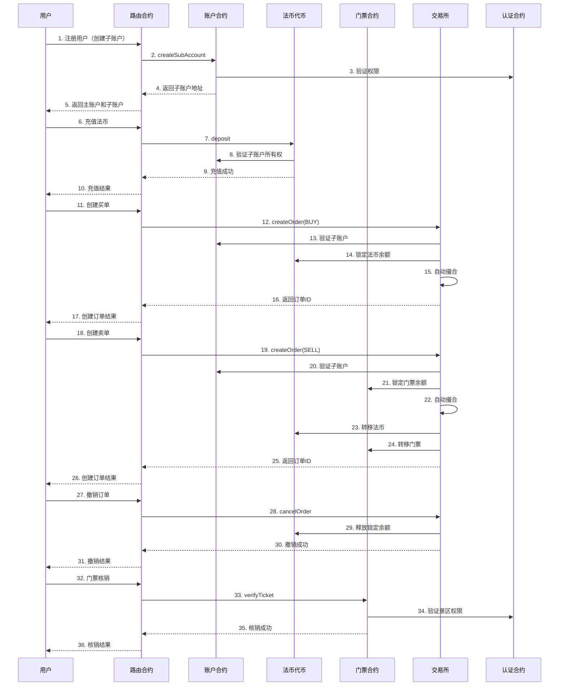

# KXDEX 合约系统分析文档

## 1. 系统架构概述

KXDEX 是一个基于以太坊智能合约的门票交易系统，采用分层架构设计，主要由以下核心组件组成：

| 组件 | 主要职责 | 实现文件 | 接口文件 |
|------|---------|----------|----------|
| 认证系统 | 角色权限管理 | Auth.sol | IAuth.sol |
| 账户系统 | 主账户/子账户管理 | Account.sol | IAccount.sol |
| 法币代币 | 法币凭证管理 | FiatToken.sol | IFiatToken.sol |
| 门票系统 | 门票发行与管理 | Ticket.sol | ITicket.sol |
| 交易所 | 订单撮合与交易 | Exchange.sol | IExchange.sol |
| 路由合约 | 统一调用接口 | Router.sol | - |
| 存储合约 | 数据持久化 | AccountStorage.sol, FiatStorage.sol, TicketStorage.sol | - |

## 2. 核心功能模块

### 2.1 认证系统 (Auth)

**功能：** 实现基于角色的访问控制 (RBAC)，管理系统中的各种角色权限。

**主要角色：**
- `ADMIN_ROLE`：系统管理员
- `REGULATOR_ROLE`：监管节点
- `BANK_ROLE`：银行节点
- `EXCHANGE_ADMIN_ROLE`：交易所管理员
- `SCENIC_OPERATOR_ROLE`：景区运营方
- `MARKET_MAKER_ROLE`：做市商
- `CONSUMER_ROLE`：消费者

**核心功能：**
- 角色授予与撤销
- 账户冻结与解冻
- 多重签名审批机制
- 权限验证

### 2.2 账户系统 (Account)

**功能：** 管理主账户和子账户，实现资产隔离和权限控制。

**账户类型：**
- `MAIN`：主账户，拥有管理权限
- `SUB`：子账户，用于实际交易和资产持有

**核心功能：**
- 主账户注册
- 子账户创建（支持批量创建）
- 账户状态管理（激活/停用）
- 子账户所有权验证
- 账户信息查询

### 2.3 法币代币系统 (FiatToken)

**功能：** 实现法币凭证的发行、转账、充值和提现。

**核心功能：**
- 银行发行法币（mint）
- 银行销毁法币（burn）
- 主账户向子账户充值
- 子账户向主账户或银行提现
- 交易转账（仅支持特定场景）

**转账规则：**
1. 子账户间可自由转账
2. 主账户可向自己的子账户转账（充值）
3. 子账户可向自己的主账户转账（提现）
4. 主账户可向银行销毁账户转账
5. 可向银行地址提现
6. 银行可自由操作
7. 交易所合约可发起转账

### 2.4 门票系统 (Ticket)

**功能：** 管理门票的发行、转移、核销和销毁。

**核心功能：**
- 景区发行门票
- 门票转账
- 门票核销（入园验证）
- 门票销毁
- 门票信息查询

**门票属性：**
- 名称、总量、价格范围
- 有效期
- 景区信息哈希
- 状态（活跃/非活跃）

### 2.5 交易所系统 (Exchange)

**功能：** 实现门票和法币的自动撮合交易。

**核心功能：**
- 订单创建（买单/卖单）
- 订单撤销
- 自动撮合
- 交易执行与结算
- 手续费收取
- 订单簿管理

**订单类型：**
- `BUY`：买单
- `SELL`：卖单

**订单状态：**
- `PENDING`：待成交
- `PARTIAL`：部分成交
- `FILLED`：完全成交
- `CANCELLED`：已撤销

## 3. 工作流程分析

### 3.1 系统初始化流程

1. **部署合约**：按顺序部署存储合约、认证合约、账户合约、法币代币合约、门票合约、交易所合约、路由合约
2. **设置权限**：管理员为各参与方分配角色（银行、景区、做市商等）
3. **初始化参数**：设置银行地址、手续费收集地址等

### 3.2 门票发行流程

1. **景区准备**：景区运营方（拥有 `SCENIC_OPERATOR_ROLE`）创建子账户
2. **发行门票**：景区调用 `issueTicket` 函数，指定门票名称、总量、价格范围、有效期等参数
3. **门票分配**：发行的门票直接进入景区的子账户

### 3.3 充值流程

1. **银行发行法币**：银行调用 `mint` 函数，向用户主账户发行法币
2. **主账户充值**：用户将法币从主账户充值到子账户，调用 `deposit` 函数

### 3.4 交易流程

#### 3.4.1 创建订单

1. **签名授权**：主账户对订单参数进行签名
2. **创建订单**：通过子账户调用 `createOrder` 函数，提交订单信息和主账户签名
3. **余额锁定**：系统自动锁定子账户中相应的资产（法币或门票）
4. **自动撮合**：系统尝试自动撮合新订单与现有订单

#### 3.4.2 订单撮合

1. **匹配检查**：系统检查买单和卖单的价格是否匹配（买价 >= 卖价）
2. **执行交易**：匹配成功后，系统执行交易，转移资产并收取手续费
3. **更新订单状态**：根据成交情况更新订单状态（部分成交/完全成交）
4. **释放锁定余额**：释放未成交部分的锁定余额

#### 3.4.3 订单撤销

1. **签名授权**：主账户对撤销操作进行签名
2. **撤销订单**：调用 `cancelOrder` 函数，提交订单ID和主账户签名
3. **释放锁定余额**：系统释放该订单的锁定余额

### 3.5 门票核销流程

1. **验证身份**：景区工作人员（拥有 `SCENIC_OPERATOR_ROLE`）发起验证
2. **核销门票**：调用 `verifyTicket` 函数，扣减持票人余额并减少总供应量
3. **记录验证**：系统记录验证事件

## 4. 安全特性

### 4.1 资产隔离

- **主账户与子账户分离**：主账户仅用于管理，子账户用于实际交易和资产持有
- **签名验证**：所有交易操作需要主账户签名授权，确保资产安全
- **余额锁定**：挂单时锁定相应资产，防止重复交易

### 4.2 权限控制

- **基于角色的访问控制**：不同角色拥有不同权限
- **多签机制**：重要操作需要多重签名批准
- **账户冻结**：监管和交易所管理员可冻结可疑账户

### 4.3 交易安全

- **价格范围限制**：门票交易价格必须在发行时设定的范围内
- **签名有效期**：签名有时间限制，防止签名被滥用
- **防重放攻击**：使用 nonce 机制防止交易重放

## 5. 技术特点

### 5.1 模块化设计

- **逻辑与存储分离**：核心逻辑合约与存储合约分离，支持逻辑合约升级
- **接口抽象**：通过接口定义各模块功能，提高代码可维护性
- **路由合约**：提供统一调用接口，简化外部调用

### 5.2 性能优化

- **索引优化**：使用映射存储订单和交易索引，避免全量扫描
- **批量操作**：支持批量创建子账户、批量转账等操作
- **撮合算法**：高效的订单撮合算法，支持自动匹配

### 5.3 可扩展性

- **合约升级**：核心逻辑合约可升级，数据存储在独立的存储合约中
- **角色扩展**：支持添加新的角色和权限
- **功能扩展**：可通过添加新合约扩展系统功能

## 6. 系统交互图

## 7. 代码优化建议

### 7.1 安全优化

1. **签名验证增强**：
   - 考虑使用 EIP-712 结构化数据签名，提高签名安全性
   - 增加签名过期时间检查，防止签名被长时间滥用

2. **重入攻击防护**：
   - 在关键函数中添加重入锁，防止重入攻击
   - 遵循 CEI（检查-效果-交互）模式

3. **权限检查增强**：
   - 对所有敏感操作添加权限检查
   - 实现更细粒度的权限控制

### 7.2 性能优化

1. **存储优化**：
   - 使用紧凑的数据结构减少存储开销
   - 考虑使用 Merkle 树存储大量数据

2. **撮合算法优化**：
   - 实现更高效的订单匹配算法
   - 考虑使用优先队列存储订单，提高匹配速度

3. **Gas 优化**：
   - 减少不必要的存储操作
   - 优化循环和条件判断，减少 Gas 消耗

### 7.3 功能优化

1. **订单管理**：
   - 添加订单过期自动撤销功能
   - 实现订单修改功能

2. **交易功能**：
   - 添加限价单和市价单支持
   - 实现批量交易功能

3. **用户体验**：
   - 提供更友好的错误信息
   - 增加交易历史查询功能

## 8. 总结

KXDEX 是一个功能完整的基于区块链的门票交易系统，采用模块化设计，实现了账户管理、法币代币、门票管理和交易撮合等核心功能。系统通过主账户和子账户分离、多重签名、资产锁定等机制确保交易安全，同时通过优化的撮合算法和存储结构提高系统性能。

该系统具有以下特点：

1. **安全性**：多重签名、资产隔离、权限控制等安全机制
2. **可扩展性**：模块化设计，支持合约升级和功能扩展
3. **高效性**：优化的撮合算法和存储结构
4. **易用性**：统一的路由接口，简化外部调用

KXDEX 系统为门票交易提供了一个透明、安全、高效的区块链解决方案，可应用于景区门票、演唱会门票、体育赛事门票等多种场景。