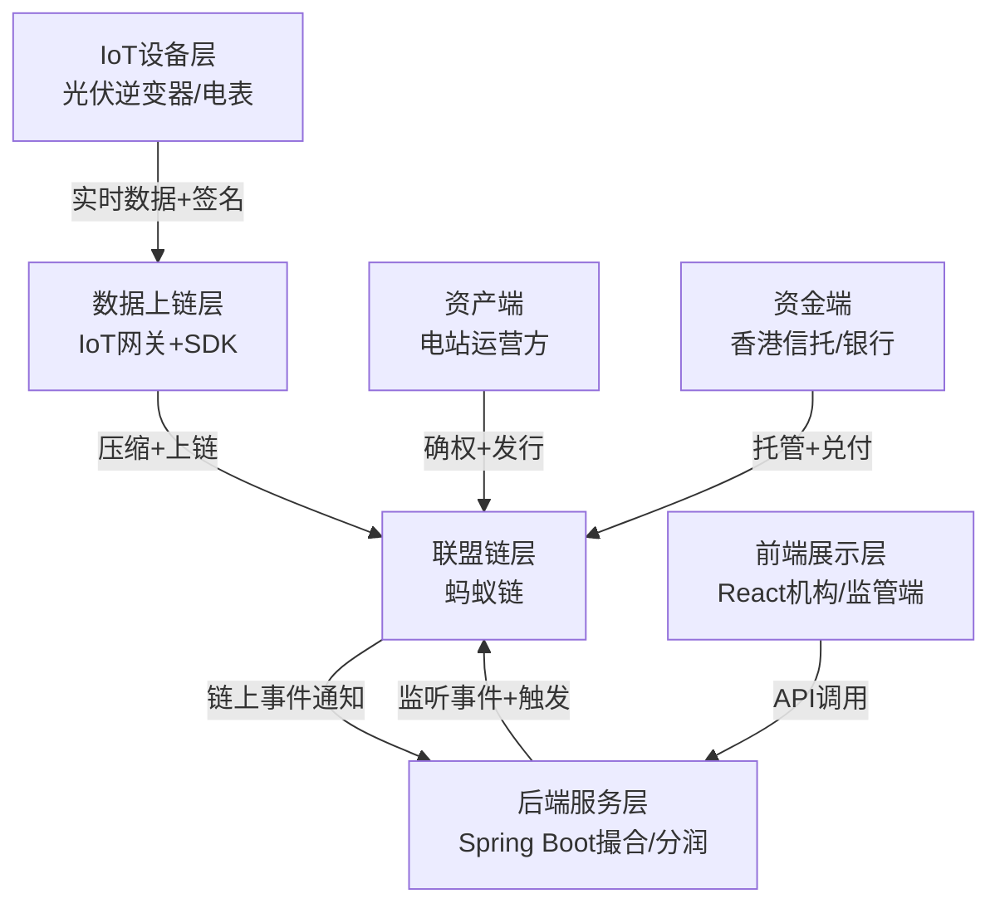
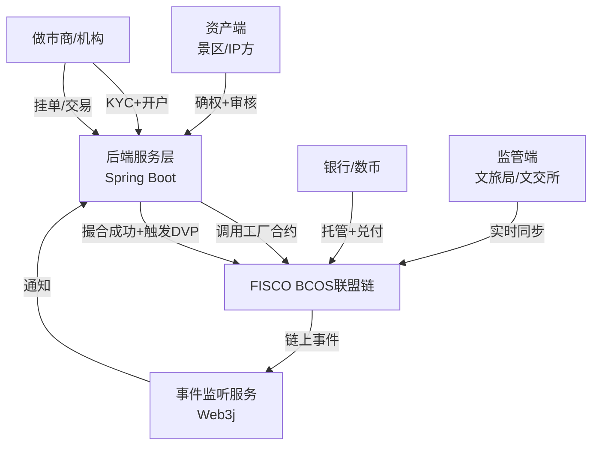
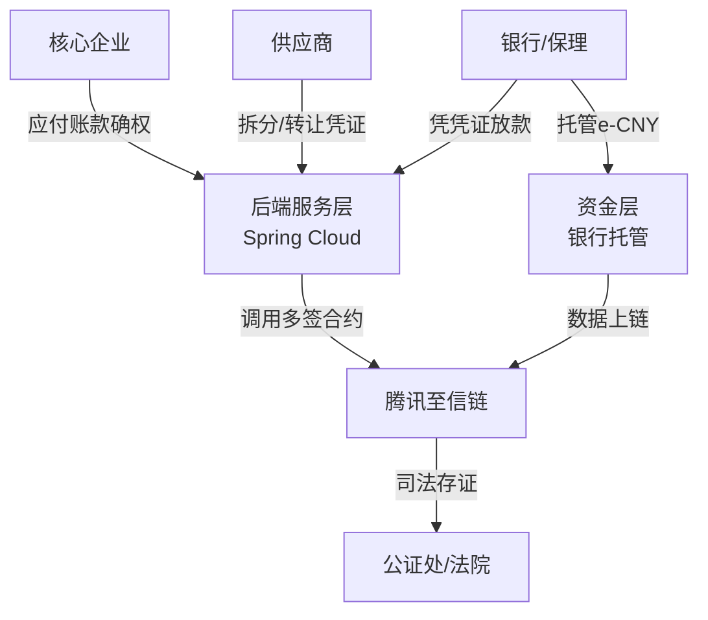

## 案例一：协鑫能科·户用光伏电站RWA（能源类，技术最完整）
### 项目背景
国内首单**实体光伏电站+链上收益权分润**RWA，底层资产为湖北/湖南82MW户用光伏电站25年电费收益权，融资超2亿元，面向香港合格机构。

---

#### 1. 技术栈选型（全栈可落地）
| 层级 | 技术选型 | 特点 |
|------|----------|------|
| **联盟链** | 蚂蚁链（AntChain）开放联盟链 | - 共识：HotStuff改进版（RW-BFT，监管节点权重30%）<br>- 性能：TPS 10000+，秒级确认<br>- 隐私：同态加密+零知识证明（隐藏敏感收益数据）<br>- 跨链：支持与香港金管局沙盒链跨链 |
| **数据上链层** | IoT设备网关+蚂蚁链IoT SDK | - 光伏逆变器数据（发电量、功率）**实时上链**<br>- 数据签名：设备私钥签名，防篡改<br>- 数据压缩：LZ4压缩后上链，降低存储成本 |
| **智能合约层** | Solidity（兼容EVM） | - 设计模式：代理合约（Proxy）+ 逻辑合约（Implementation）<br>- 权限：OpenZeppelin Ownable2Step + AccessControl |
| **后端层** | Spring Boot + MyBatis-Plus + Redis | - 撮合/分润引擎：异步处理，Redis做分布式锁<br>- 链上监听：Web3j SDK实时监听链上事件<br>- 对账：每日链上链下数据自动校验 |
| **前端层** | React + Ant Design + ECharts | - 机构端：资产看板、收益曲线、分润明细<br>- 监管端：实时监控、审计追溯、数据导出 |
| **资金层** | 香港信托托管 + 银行API对接 | - 资金流：法币入信托 → 链上增发通证 → 分润自动打款<br>- 信息流：信托数据实时上链存证 |

---

#### 2. 核心架构（分层解耦，可直接复用）

**架构特点**：
- **数据驱动**：IoT数据直接上链，作为收益分润的唯一依据，不可篡改；
- **链上链下协同**：复杂业务（撮合、分润计算）在链下，核心逻辑（资产确权、分润执行、通证销毁）在链上；
- **监管友好**：监管节点实时同步全量数据，可审计、可追溯。

---

#### 3. 智能合约逻辑
##### （1）核心合约组成
| 合约名称 | 作用 | 设计模式 |
|----------|------|----------|
| `AssetProxy` | 代理合约，永久地址，用户交互入口 | Transparent Proxy |
| `AssetLogicV1/V2` | 逻辑合约，实现具体业务，可升级 | UUPS升级模式 |
| `RevenueToken` | 收益权通证，1:1锚定电站 | ERC20 + 销毁逻辑 |
| `Oracle` | 预言机合约，接收IoT发电量数据 | 多签验证数据 |

##### （2）核心业务逻辑（Solidity伪代码）
```solidity
// 1. 资产发行：只有运营方EOA+多签能发行
function issueAsset(
    address investor, 
    uint256 amount, 
    bytes32 assetId,
    bytes[] calldata signatures // 3/5多签
) external onlyRole(OPERATOR_ROLE) {
    verifyMultiSign(signatures); // 验证多签
    require(assetInventory[assetId] >= amount, "Insufficient inventory");
    assetInventory[assetId] -= amount;
    RevenueToken.mint(investor, amount); // 1:1 mint
    emit AssetIssued(assetId, investor, amount);
}

// 2. 收益分润：预言机触发，自动执行
function distributeRevenue(
    bytes32 assetId,
    uint256 totalRevenue,
    bytes calldata oracleSignature
) external onlyRole(ORACLE_ROLE) {
    verifyOracleSignature(oracleSignature); // 验证IoT数据签名
    uint256 revenuePerToken = totalRevenue / RevenueToken.totalSupply();
    // 遍历持有人，自动分润（实际用Merkle Tree优化，避免gas过高）
    for (uint i = 0; i < holders.length; i++) {
        uint256 reward = holders[i].balance * revenuePerToken;
        RevenueToken.transfer(holders[i].addr, reward);
    }
    emit RevenueDistributed(assetId, totalRevenue);
}

// 3. 通证赎回：到期/提前赎回，自动销毁
function redeem(uint256 amount) external {
    require(RevenueToken.balanceOf(msg.sender) >= amount, "Insufficient balance");
    RevenueToken.burn(msg.sender, amount); // 销毁通证
    assetInventory[assetId] += amount; // 释放资产额度
    emit Redeemed(msg.sender, amount);
    // 触发链下事件，通知银行兑付法币
}
```

---

#### 4. 联盟治理规则（监管友好，可直接套用）
| 治理维度 | 规则 |
|----------|------|
| **节点组成** | 1. 共识节点：运营方、银行、监管方、技术方（4个）<br>2. 同步节点：投资人、审计机构（仅同步数据，不参与共识）<br>3. 监管节点：香港金管局、证监会（权重30%，可暂停合约） |
| **权限分配** | - 发行/赎回：运营方EOA + 3/5多签（银行+监管+技术方）<br>- 合约升级：治理委员会2/3投票通过 + 监管节点确认<br>- 紧急暂停：监管节点单签可暂停（极端漏洞场景） |
| **数据治理** | - IoT数据：设备私钥签名 + 预言机多签验证<br>- 业务数据：每日链上链下对账，不一致自动预警<br>- 审计数据：永久存证，支持第三方审计机构随时导出 |
| **升级规则** | - 采用UUPS代理升级模式，逻辑合约可替换<br>- 升级前需公示7天，无异议后执行<br>- 升级后需监管节点确认才能生效 |

---

#### 5. 可借鉴到门票场景的技术点
| 借鉴点 | 具体应用 |
|--------|----------|
| **IoT数据上链** | 景区入园闸机数据实时上链，作为门票核销的唯一依据，防假票、防二次入园 |
| **代理合约+可升级** | 门票合约、撮合合约采用代理模式，业务迭代时无需更换地址 |
| **预言机+多签验证数据** | 入园数据、交易数据通过预言机上链，多签验证防篡改 |
| **链上链下协同** | 复杂撮合在Spring Boot后端，核心交割（DVP）、核销、销毁在链上 |
| **监管节点权重设计** | 文旅局、银行作为监管节点，权重30%，可紧急暂停异常合约 |

---

## 案例二：浙文交所·数文链
### 项目背景
浙江文交所主导的**文化数字权益流转平台**，底层资产为非遗、艺术品、景区门票/体验权益，支持挂牌、询价、撮合、链上交割，是国内最成熟的文旅RWA交易所。

---

#### 1. 技术栈选型
| 层级 | 技术选型 | 特点 |
|------|----------|------|
| **联盟链** | FISCO BCOS 3.0 | - 共识：PBFT（联盟内节点）<br>- 性能：TPS 5000+，秒级确认<br>- 隐私：同态加密+群组隔离（不同资产在不同群组）<br>- 国密：支持SM2/SM3/SM4，符合国内合规要求 |
| **智能合约层** | Solidity（FISCO EVM兼容） | - 设计模式：工厂合约（Factory）+ 单例合约<br>- 权限：FISCO内置权限控制（PermissionManager） |
| **后端层** | Spring Boot + MyBatis-Plus + RocketMQ | - 撮合引擎：RocketMQ异步撮合，高并发<br>- 链上交互：FISCO Java SDK<br>- 事件监听：Web3j + 事件队列 |
| **前端层** | React + Material-UI + ECharts（你正在用！） | - 交易端：盘口、K线、订单管理<br>- 管理端：资产审核、KYC、风控监控 |
| **资金层** | 银行托管 + 数字人民币接口 | - 法币通证：1:1锚定数字人民币<br>- 交割：DVP原子交割 |

---

#### 2. 核心架构

**架构特点**：
- **工厂合约批量发行**：每个景区/IP通过工厂合约生成独立的门票通证合约，资产隔离；
- **群组隔离隐私保护**：不同景区的门票在不同FISCO群组，数据互不可见；
- **国密合规**：全链路支持SM2/SM3/SM4，符合国内监管要求。

---

#### 3. 智能合约逻辑（核心代码逻辑，可直接用于你的门票）
##### （1）核心合约组成
| 合约名称 | 作用 |
|----------|------|
| `TicketFactory` | 工厂合约，为每个景区生成独立的门票合约 |
| `TicketERC1155` | 门票通证合约（ERC1155，支持多场次门票） |
| `MatchingDVP` | 撮合交割合约，实现原子DVP |
| `Burner` | 销毁合约，门票核销后自动销毁 |
| `PermissionManager` | FISCO内置权限合约，控制合约调用权限 |

##### （2）核心业务逻辑（Solidity伪代码，FISCO适配）
```solidity
// 1. 工厂合约：生成景区独立门票合约
function createTicketContract(
    address scenicEOA,
    string calldata scenicName,
    bytes32 scenicId
) external onlyRole(PLATFORM_ADMIN) returns (address) {
    TicketERC1155 ticketContract = new TicketERC1155(scenicEOA, scenicName, scenicId);
    ticketContracts[scenicId] = address(ticketContract);
    emit TicketContractCreated(scenicId, address(ticketContract));
    return address(ticketContract);
}

// 2. 门票合约：发行、转让、核销（ERC1155）
contract TicketERC1155 is ERC1155, AccessControl {
    bytes32 public constant SCENIC_ROLE = keccak256("SCENIC_ROLE");
    bytes32 public constant BURNER_ROLE = keccak256("BURNER_ROLE");
    mapping(uint256 => uint256) public ticketInventory; // 场次ID → 库存

    constructor(address scenicEOA, string memory scenicName, bytes32 scenicId) {
        _grantRole(SCENIC_ROLE, scenicEOA);
        _grantRole(BURNER_ROLE, burnerContract);
    }

    // 景区发行门票
    function issue(uint256 sessionId, uint256 amount) external onlyRole(SCENIC_ROLE) {
        require(ticketInventory[sessionId] >= amount, "Insufficient inventory");
        _mint(msg.sender, sessionId, amount, "");
        ticketInventory[sessionId] -= amount;
        emit TicketIssued(sessionId, amount);
    }

    // 核销门票（仅销毁合约可调用）
    function burn(address holder, uint256 sessionId, uint256 amount) external onlyRole(BURNER_ROLE) {
        _burn(holder, sessionId, amount);
        emit TicketBurned(holder, sessionId, amount);
    }
}

// 3. 撮合交割合约：原子DVP（钱票两清）
function matchAndSettle(
    address buyer,
    address seller,
    address ticketContract,
    uint256 sessionId,
    uint256 ticketAmount,
    uint256 stablecoinAmount
) external onlyRole(MATCHING_ENGINE) {
    // 1. 检查买方法币通证余额
    require(Stablecoin.balanceOf(buyer) >= stablecoinAmount, "Insufficient stablecoin");
    // 2. 检查卖方门票余额
    require(TicketERC1155(ticketContract).balanceOf(seller, sessionId) >= ticketAmount, "Insufficient ticket");
    // 3. 原子划转：钱→卖方，票→买方
    Stablecoin.transferFrom(buyer, seller, stablecoinAmount);
    TicketERC1155(ticketContract).safeTransferFrom(seller, buyer, sessionId, ticketAmount, "");
    emit MatchedAndSettled(buyer, seller, sessionId, ticketAmount, stablecoinAmount);
}
```

---

#### 4. 联盟治理规则（文旅类标准治理）
| 治理维度 | 规则 |
|----------|------|
| **节点组成** | 1. 共识节点：浙文交所、银行、文旅局、技术方（4个）<br>2. 同步节点：景区、做市商、审计机构<br>3. 监管节点：浙江省文旅厅、金融局（可查看全量数据） |
| **权限分配** | - 资产发行：景区EOA + 平台审核<br>- 合约升级：浙文交所 + 银行 + 文旅局 2/3多签<br>- 交易权限：仅完成KYC的机构可调用撮合合约 |
| **群组隔离** | - 每个景区/IP在独立的FISCO群组<br>- 跨群组交易需通过跨链网关<br>- 监管节点可访问所有群组 |
| **审计规则** | - 所有交易、发行、核销数据永久存证<br>- 每日生成审计报告，推送监管方<br>- 支持第三方审计机构随时导出链上数据 |

---

#### 5. 可借鉴到门票场景的技术点
| 借鉴点 | 具体应用 |
|--------|----------|
| **FISCO BCOS 3.0 + 国密** | 直接用你现有的FISCO技术栈，全链路国密合规 |
| **工厂合约 + ERC1155** | 每个景区通过工厂合约生成独立门票合约，ERC1155支持多场次门票 |
| **原子DVP交割合约** | 撮合成功后链上自动钱票两清，不可违约 |
| **群组隔离** | 不同景区在不同FISCO群组，保护商业隐私 |
| **FISCO内置权限控制** | 用PermissionManager控制合约调用权限，无需自己写 |

---

## 案例三：大型制造集团·供应链应收账款RWA（合规最严，资金闭环最完善）
### 项目背景
国内某大型制造集团主导的**供应链应收账款RWA平台**，底层资产为核心企业应付账款，确权后上链为数字债权凭证，支持拆分、转让、融资，是国内合规最严的RWA资金闭环案例。

---

#### 1. 技术栈选型（资金安全优先）
| 层级 | 技术选型 | 特点 |
|------|----------|------|
| **联盟链** | 腾讯至信链（TrustSQL） | - 共识：PoA+PBFT混合共识<br>- 隐私：零知识证明（隐藏交易金额）<br>- 存证：司法存证，直接作为法律证据 |
| **智能合约层** | Solidity + 腾讯云合约审计 | - 设计模式：多签钱包（Gnosis Safe）+ 时间锁（Timelock）<br>- 安全：上线前腾讯云第三方审计 |
| **后端层** | Spring Cloud Alibaba + Nacos + Seata | - 分布式事务：Seata保证链上链下数据一致<br>- 服务治理：Nacos服务注册发现<br>- 风控：实时风控引擎，拦截异常交易 |
| **资金层** | 银行托管 + 央行数字人民币e-CNY | - 资金流：e-CNY入托管 → 链上增发凭证<br>- 信息流：托管数据实时上链，司法存证 |

---

#### 2. 核心架构（资金闭环最完善）

**架构特点**：
- **多签+时间锁**：所有核心操作需多签+时间锁，杜绝单点风险；
- **司法存证**：链上数据直接同步公证处，可作为法律证据；
- **分布式事务**：Seata保证链上链下数据一致，不出现“钱票不一致”。

---

#### 3. 智能合约逻辑（资金安全优先）
##### （1）核心合约组成
| 合约名称 | 作用 |
|----------|------|
| `GnosisSafe` | 多签钱包，控制所有核心操作 |
| `TimelockController` | 时间锁，核心操作需等待48小时无异议后执行 |
| `DebtToken` | 数字债权凭证，1:1锚定应收账款 |
| `Escrow` | 托管合约，放款/还款托管 |

##### （2）核心业务逻辑（Solidity伪代码）
```solidity
// 1. 多签+时间锁：核心操作流程
function proposeOperation(
    address target,
    uint256 value,
    bytes calldata data,
    string calldata description
) external onlyRole(SIGNER_ROLE) {
    bytes32 operationId = keccak256(abi.encode(target, value, data));
    timelock.schedule(target, value, data, 0, 48 hours); // 48小时时间锁
    emit OperationProposed(operationId, description);
}

// 2. 数字债权凭证：确权、转让、融资
function issueDebt(
    address supplier,
    uint256 amount,
    bytes32 debtId,
    bytes[] calldata signatures // 核心企业+银行+平台 3/3多签
) external onlyRole(GNOSIS_SAFE) {
    verifyMultiSign(signatures);
    DebtToken.mint(supplier, amount);
    emit DebtIssued(debtId, supplier, amount);
}

// 3. 托管合约：放款/还款托管
function escrowRepay(
    address lender,
    uint256 amount,
    bytes32 debtId
) external onlyRole(GNOSIS_SAFE) {
    require(DebtToken.balanceOf(msg.sender) >= amount, "Insufficient debt");
    DebtToken.burn(msg.sender, amount);
    Stablecoin.transfer(lender, amount);
    emit Repaid(debtId, lender, amount);
}
```

---

#### 4. 联盟治理规则（合规最严）
| 治理维度 | 规则 |
|----------|------|
| **节点组成** | 1. 共识节点：核心企业、银行、平台、公证处（4个）<br>2. 同步节点：供应商、保理机构<br>3. 监管节点：银保监会、央行（可实时监控） |
| **权限分配** | - 所有核心操作：Gnosis Safe 3/3多签（核心企业+银行+平台）<br>- 合约升级：时间锁48小时 + 监管节点确认<br>- 紧急暂停：监管节点+银行 2/2多签 |
| **司法存证** | - 所有链上数据实时同步公证处<br>- 公证书自动生成，可直接作为法律证据<br>- 支持法院在线调取链上数据 |
| **风控规则** | - 实时风控引擎，拦截异常交易<br>- 大额交易需人工审核<br>- 交易限额、频率限制 |

---

#### 5. 可借鉴到门票场景的技术点
| 借鉴点 | 具体应用 |
|--------|----------|
| **多签+时间锁** | 门票发行、合约升级采用多签+时间锁，杜绝单点风险 |
| **司法存证** | 链上交易、核销数据同步公证处，作为法律证据，防纠纷 |
| **分布式事务Seata** | 保证链上链下数据一致，不出现“钱票不一致” |
| **实时风控引擎** | 拦截异常交易、大额交易，保障资金安全 |

---

## 综合借鉴清单（直接用于你的门票RWA+链上交易所）
结合三个案例的技术亮点，我给你整理了**可直接落地的技术借鉴清单**，按优先级排序：

### 优先级1：必须直接抄（技术成熟、合规必需）
1. **FISCO BCOS 3.0 + 国密**：用你现有的技术栈，全链路SM2/SM3/SM4合规；
2. **工厂合约 + ERC1155门票合约**：每个景区生成独立合约，ERC1155支持多场次；
3. **原子DVP撮合交割合约**：链上自动钱票两清，不可违约；
4. **代理合约+可升级**：门票、撮合合约采用代理模式，业务迭代无需换地址；
5. **链上链下协同**：复杂撮合在Spring Boot后端，核心交割/核销/销毁在链上。

### 优先级2：强烈建议加（提升安全性、信任度）
1. **多签+时间锁**：门票发行、合约升级采用3/5多签+48小时时间锁；
2. **监管节点权重设计**：文旅局、银行作为监管节点，权重30%，可紧急暂停；
3. **司法存证**：链上数据同步公证处，作为法律证据；
4. **IoT入园数据上链**：闸机数据实时上链，作为核销唯一依据，防假票；
5. **预言机+多签验证数据**：入园、交易数据通过预言机上链，多签验证防篡改。

### 优先级3：可选优化（提升性能、体验）
1. **群组隔离**：不同景区在不同FISCO群组，保护商业隐私；
2. **分布式事务Seata**：保证链上链下数据一致；
3. **实时风控引擎**：拦截异常交易、大额交易；
4. **Merkle Tree优化分润/分红**：避免链上遍历，降低gas（FISCO无gas，但提升性能）；
5. **前端React+Material-UI+ECharts**：用你现有的技术栈，快速开发盘口、K线。

---
